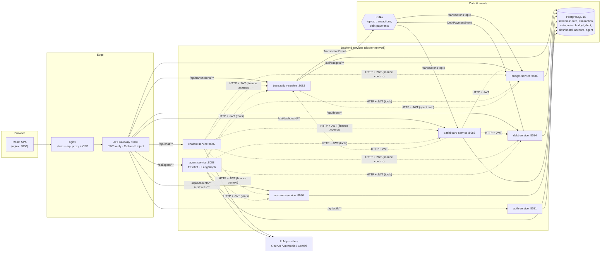
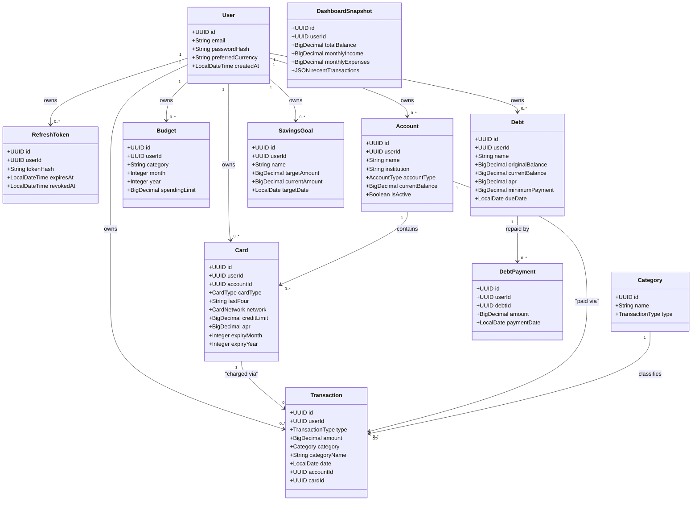
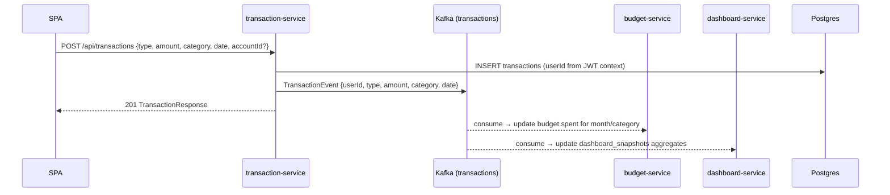
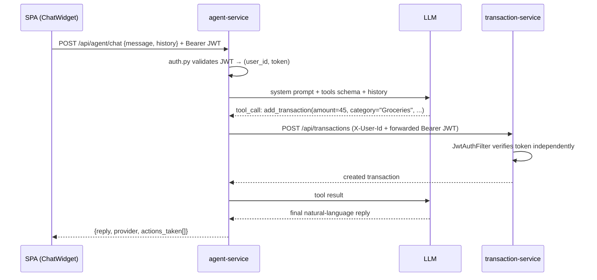
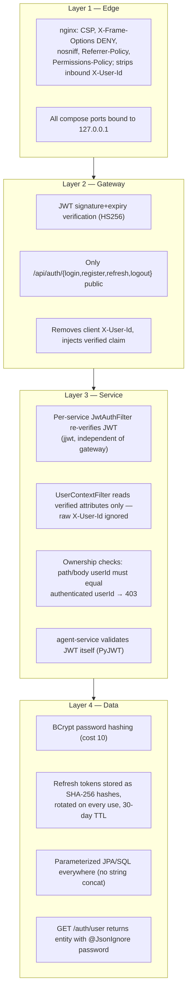
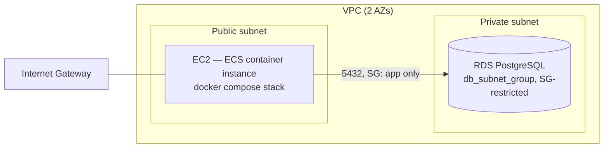

# Personal Finance Tracker — Final Technical Report

## 1. Executive Summary

A full-stack personal finance application built as an event-driven microservices system. Users track accounts, cards, transactions, budgets, debts, and savings goals through a React SPA, an API gateway, eight backend services (seven JVM/Spring Boot + one Python/FastAPI), a Kafka event backbone, a single PostgreSQL database with per-service schemas, and an LLM-powered agent that can both answer questions and mutate financial data through typed tools.

The system was hardened in a dedicated security pass: every service now independently validates JWTs (defense in depth behind the gateway), the refresh token lives only in an `HttpOnly` cookie, all compose-published ports bind to localhost, and no credentials are committed to the repository.

---

## 2. Technology Stack

| Layer | Technology |
|---|---|
| Frontend | React 18 + TypeScript, Vite, Tailwind CSS, Zustand, Sonner, React Router-less view state |
| API Gateway | Spring Cloud Gateway (Spring Boot 3.3, Java 21) |
| Domain services | Spring Boot 3.3, Java 21, Spring Data JPA, Flyway |
| Agent service | Python 3.12, FastAPI, LangGraph, LangChain (OpenAI / Anthropic / Gemini adapters) |
| Messaging | Apache Kafka (Confluent 7.5) + Zookeeper |
| Database | PostgreSQL 15, one database, schema-per-service |
| Auth | JWT (HS256, jjwt 0.12.3) access tokens + opaque rotating refresh tokens |
| Edge | nginx (static SPA + `/api` reverse proxy, security headers, CSP) |
| Observability | Prometheus, Grafana, Elasticsearch, Kibana, Filebeat, Micrometer |
| Cloud deploy | Terraform → AWS (VPC, public/private subnets, EC2+ECS, RDS PostgreSQL) |
| CI/CD | GitHub Actions (CI tests, CD builds/pushes images, SSH deploy + health checks) |

---

## 3. System Architecture



**Key design decision — schema-per-service, single database.** Each service owns a PostgreSQL schema (`auth`, `transaction`, `categories`, `budget`, `debt`, `dashboard`, `account`, `agent`) and runs Flyway migrations independently. This gives service-level data ownership without the operational cost of eight databases — appropriate for a single-deployment personal app, and it keeps the door open to splitting databases later.

---

## 4. Service Catalog

| Service | Port | Responsibility | Owns schema | Talks to |
|---|---|---|---|---|
| auth-service | 8081 | Register, login, JWT issue, refresh-token rotation, logout, rate limiting | `auth` | Postgres |
| transaction-service | 8082 | Transaction + category CRUD, ownership checks, publishes `TransactionEvent` | `transaction`, `categories` | Postgres, Kafka |
| budget-service | 8083 | Monthly category budgets; consumes transaction events to track spend | `budget` | Postgres, Kafka, → transaction-service |
| debt-service | 8084 | Debts + payments; publishes `DebtPaymentEvent` | `debt` | Postgres, Kafka |
| dashboard-service | 8085 | Aggregated summary/snapshots; consumes transaction events; fan-out reads | `dashboard` | Postgres, Kafka, → TX/BUD/DBT |
| accounts-service | 8086 | Bank accounts and credit/debit cards | `account` | Postgres |
| chatbot-service | 8087 | RAG-less finance Q&A: injects user finance snapshot into LLM prompt | — | → all read services, LLM |
| agent-service | 8088 | LangGraph ReAct agent: 10 tools that can *mutate* data + goals + payoff analysis | `agent` (savings_goals) | → all services, Postgres, LLM |
| api-gateway | 8080 | Routing, JWT verification, `X-User-Id` injection, CORS | — | all services |

---

## 5. Domain Model (UML)



Ownership is enforced at the service layer: every repository query is scoped by `userId`, and services compare the path/body `userId` against the authenticated identity, returning 403 on mismatch.

---

## 6. Key Flows

### 6.1 Authentication & session lifecycle

```mermaid
sequenceDiagram
    participant U as Browser (React)
    participant NGX as nginx
    participant GW as Gateway
    participant A as auth-service
    participant DB as Postgres (auth schema)

    U->>NGX: POST /api/auth/login {email, password}
    NGX->>GW: proxy /api
    GW->>A: public route (no JWT required)
    A->>DB: findByEmail + BCrypt matches
    A->>DB: INSERT refresh_tokens (SHA-256 hash only)
    A-->>U: 200 {token (JWT, 15m), userId, email} + Set-Cookie: refresh_token (HttpOnly, SameSite=Strict, Path=/api/auth)

    Note over U: access token held in JS memory only

    U->>GW: GET /api/transactions (Bearer JWT)
    GW->>GW: verify signature+expiry, strip client X-User-Id, inject verified value
    GW->>TX: forward + Authorization header
    TX->>TX: JwtAuthFilter re-verifies JWT independently

    U->>GW: POST /api/auth/refresh (cookie auto-sent)
    GW->>A: public route
    A->>DB: lookup tokenHash, check revoked/expiry
    A->>DB: revoke old token (rotation)
    A-->>U: new JWT + rotated refresh cookie

    U->>GW: POST /api/auth/logout
    A->>DB: set revoked_at; clears cookie
```

Rate limiting: `RateLimitFilter` caps login/register at 10 req/min per IP (in-memory sliding window).

### 6.2 Transaction → event fan-out



### 6.3 Agent tool call (LangGraph ReAct)



The token is passed **explicitly** through `run_agent → build_tools → services_client` rather than via contextvars, because LangGraph executes tool nodes on executor threads where request context would not propagate.

---

## 7. Security Architecture

Defense is layered; each layer stands alone if an outer one fails.



Additional controls:

- **Secrets**: `JWT_SECRET`, `POSTGRES_PASSWORD`, `GRAFANA_ADMIN_PASSWORD`, LLM keys all come from env/`.env` (gitignored); compose fails fast (`:?`) if unset. No credential literals remain in tracked files.
- **Token storage**: access token in JS memory only; refresh token in `HttpOnly; SameSite=Strict` cookie scoped to `Path=/api/auth`. XSS cannot exfiltrate a persistent credential.
- **Input validation**: `@Email`/`@NotBlank`/`@Size` on auth DTOs; Pydantic `Field` constraints on agent endpoints; message length capped at 4000 chars.
- **Internal service calls** propagate the user's Bearer token (budget WebClient, dashboard WebClient, chatbot `FinanceContextService`, agent `services_client`) so downstream filters accept them — while still verifying the JWT independently.
- **Kafka**: events keyed by `userId`; consumers are idempotent upserts into snapshot/aggregate tables.

### Known residual risks (accepted for a personal deployment)

- Access token remains usable by injected JS during its ~15-min lifetime (inherent to bearer tokens without a BFF).
- No TLS termination in the compose stack — deploy behind HTTPS in production and set `COOKIE_SECURE=true`.
- Kafka/Zookeeper/Elasticsearch run with no auth inside the docker network (localhost-bound ports mitigate external exposure).
- Demo seed users (`password123`) exist for development only.
- Terraform `tfstate`/`tfvars` contain the RDS password in plaintext locally (gitignored; rotate if shared).

---

## 8. Data Flow Summary

| Flow | Path |
|---|---|
| Write transaction | SPA → nginx → gateway (JWT) → transaction-service → Postgres + Kafka `transactions` → budget & dashboard consumers update aggregates |
| Read dashboard | SPA → gateway → dashboard-service → Postgres snapshot + synchronous fan-out to TX/BUD/DBT with forwarded JWT |
| Chat Q&A | SPA → gateway → chatbot-service → gathers finance JSON from 5 services (forwarded JWT) → LLM → reply |
| Agent action | SPA → gateway → agent-service (JWT) → LangGraph tool → downstream service (forwarded JWT) → mutation + event |
| Debt payoff | agent-service `/debts/payoff-plan` → pulls debts + payment history → `payoff.py` simulates avalanche vs snowball month-by-month |
| Savings plan | agent-service → transactions + `agent.savings_goals` → `goals.build_plan` computes surplus, required vs recommended contribution, top categories to trim |

---

## 9. Infrastructure

### Local (docker compose)

Single `docker-compose.yml` (and `.dev` variant) brings up 17 containers on `finance-network`: Zookeeper, Kafka, Postgres, 8 app services, gateway, Prometheus, Grafana, Elasticsearch, Kibana, Filebeat, frontend. All ports publish on `127.0.0.1` only. Health checks gate startup order; LLM keys are optional env passthroughs.

### AWS (Terraform)



Resources: VPC + IGW + public/private subnets + route tables, ECS cluster + task definition + service, EC2 instance with IAM instance profile, RDS instance with dedicated security group, ECR-published images (`hatimrangwala/finance-*`). Terraform state and tfvars are gitignored. `deploy.sh`/`destroy.sh` wrap init/plan/apply.

---

## 10. Frontend Structure

```
src/
  context/AuthContext.tsx      session state, login/register/logout, guest mode, restore-on-load
  lib/
    session.ts                 in-memory access token + refreshSession()
    api.ts                     typed API client (Bearer from memory)
    authInterceptor.ts         fetch wrapper: 401 → refresh → retry once
  store/useFinanceStore.ts     Zustand store: transactions, budgets, debts, accounts, cards
  screens/                     Overview, Transactions, Analytics, Budgets, Debts, Accounts, StartPage
  components/                  Sidebar, ChatWidget, AddTransactionForm, AccountForm, CardForm, ui/*
```

Views are client-side state (`currentView`), not routes. All API calls go through `/api` → nginx → gateway.

---

## 11. Testing & Quality

- **Unit tests**: JUnit 5 + Mockito per Java service (`*ServiceTest`, `*ControllerTest`-adjacent); Vitest + Testing Library for frontend (29 tests passing); pytest for `agent-service` payoff math.
- **Integration tests**: `@SpringBootTest` slices per service (`*IntegrationTest`).
- **E2E**: Playwright specs for auth, accounts, transactions, budgets, debts flows.
- **CI**: `.github/workflows/ci.yml` runs builds/tests; `cd.yml` builds images, pushes to Docker Hub, SSH-deploys, and health-checks `/actuator/health` endpoints.
- **Docs**: `TESTING.md`, `checklist.md`, `DEPLOYMENT_ARCHITECTURE.md`, per-service READMEs.

---

## 12. Engineering Highlights

1. **Zero-trust service mesh (poor man's version)**: the gateway is not a trust boundary — every service re-verifies the JWT, so a compromised or bypassed gateway still can't forge identity.
2. **Event-driven aggregates without a separate read DB**: Kafka fans transactions out to budget tracking and dashboard snapshots, keeping write and read paths decoupled.
3. **Agent safety through typed tools**: the LLM never touches the DB or services directly — it can only invoke 10 schema-validated tools, each scoped to the authenticated `user_id`.
4. **Payoff engine as pure functions**: `payoff.py` simulates avalanche vs snowball deterministically from real debt + payment history — explainable, testable, no LLM in the math path.
5. **Secret hygiene enforced mechanically**: compose `:?` interpolation fails the deploy rather than silently using a weak default.
